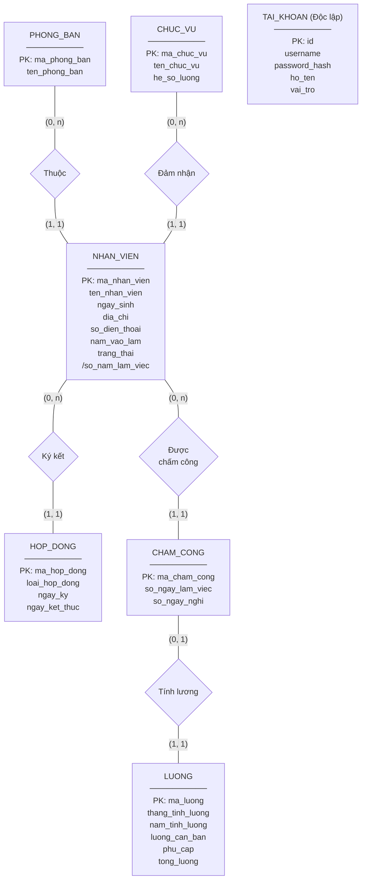
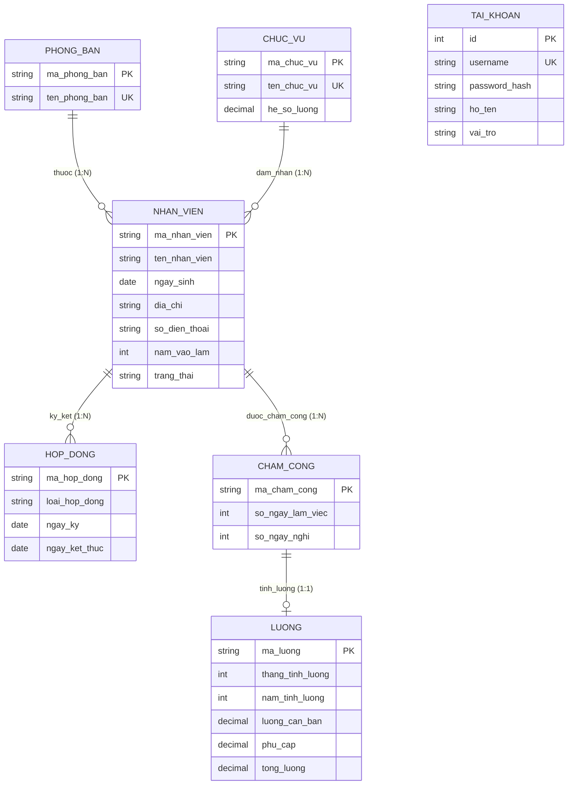
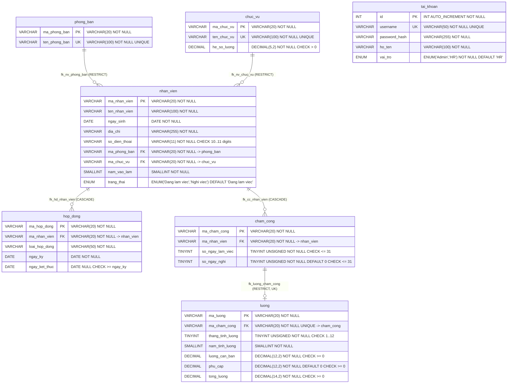

# Thiết Kế Mô Hình E-R và Mô Hình Vật Lý — Hệ Thống Quản Lý Nhân Sự (HRM)

Tài liệu này đặc tả thiết kế cơ sở dữ liệu ở hai mức **Quan niệm (Mô hình E-R / CDM)** và **Vật lý (Mô hình PDM trên MySQL 8.x)** của dự án Quản lý Nhân sự, đối chiếu trực tiếp với lược đồ triển khai tại [`src/db/schema.sql`](../src/db/schema.sql), dữ liệu mẫu tại [`src/db/seed.sql`](../src/db/seed.sql) và tệp sơ đồ [`docs/database-design.drawio`](./database-design.drawio).

---

## Phần I. Mô Hình Thực Thể - Kết Hợp (Mô Hình E-R / CDM)

> **Quy ước mức quan niệm:** Các tập thực thể chỉ chứa thuộc tính nội tại (không chứa khóa ngoại). Các liên kết nghiệp vụ được biểu diễn qua mối kết hợp kèm bản số `(min, max)`. Thực thể hệ thống `TAI_KHOAN` phục vụ xác thực và phân quyền (`Admin`, `HR`), hoạt động độc lập với các thực thể nghiệp vụ nhân sự.

### 1.1. Danh sách các tập thực thể và thuộc tính

| Tập thực thể | Khóa định danh (Identifier) | Các thuộc tính mô tả | Thuộc tính dẫn xuất / Ghi chú |
| :--- | :--- | :--- | :--- |
| **PHONG_BAN** | `ma_phong_ban` | `ten_phong_ban` (duy nhất) | Danh mục phòng ban trong doanh nghiệp |
| **CHUC_VU** | `ma_chuc_vu` | `ten_chuc_vu` (duy nhất), `he_so_luong` | Danh mục chức danh và hệ số lương (`> 0`) |
| **NHAN_VIEN** | `ma_nhan_vien` | `ten_nhan_vien`, `ngay_sinh`, `dia_chi`, `so_dien_thoai`, `nam_vao_lam`, `trang_thai` | `/so_nam_lam_viec` (dẫn xuất từ `nam_vao_lam` qua hàm `fn_so_nam_lam_viec`) |
| **HOP_DONG** | `ma_hop_dong` | `loai_hop_dong`, `ngay_ky`, `ngay_ket_thuc` (có thể rỗng) | Khi `ngay_ket_thuc` khác rỗng, nhân viên chuyển sang `Nghỉ việc` |
| **CHAM_CONG** | `ma_cham_cong` | `so_ngay_lam_viec`, `so_ngay_nghi` | Ghi nhận ngày công thực tế (`0..31`) của một nhân viên |
| **LUONG** | `ma_luong` | `thang_tinh_luong`, `nam_tinh_luong`, `luong_can_ban`, `phu_cap`, `tong_luong` | `tong_luong` chốt từ lương căn bản, hệ số lương, ngày công và phụ cấp |
| **TAI_KHOAN** *(Hệ thống)* | `id` | `username` (duy nhất), `password_hash`, `ho_ten`, `vai_tro` | Thực thể độc lập dùng cho đăng nhập & phân quyền (`Admin`, `HR`) |

---

### 1.2. Các mối kết hợp (Relationships) và Bản số `(min, max)`

| Mối kết hợp | Thực thể A | Bản số phía A | Thực thể B | Bản số phía B | Loại liên kết | Quy tắc nghiệp vụ |
| :--- | :--- | :---: | :--- | :---: | :---: | :--- |
| **Thuộc** | `PHONG_BAN` | `(0, n)` | `NHAN_VIEN` | `(1, 1)` | **1 : N** | Một phòng ban có từ 0 đến nhiều nhân viên; mỗi nhân viên bắt buộc thuộc duy nhất 1 phòng ban. |
| **Đảm nhận** | `CHUC_VU` | `(0, n)` | `NHAN_VIEN` | `(1, 1)` | **1 : N** | Một chức vụ có 0 hoặc nhiều nhân viên đảm nhận; mỗi nhân viên giữ duy nhất 1 chức vụ hiện hành. |
| **Ký kết** | `NHAN_VIEN` | `(0, n)` | `HOP_DONG` | `(1, 1)` | **1 : N** | Một nhân viên có 0 hoặc nhiều hợp đồng lao động theo từng giai đoạn; mỗi hợp đồng thuộc về đúng 1 nhân viên. |
| **Được chấm công** | `NHAN_VIEN` | `(0, n)` | `CHAM_CONG` | `(1, 1)` | **1 : N** | Một nhân viên có 0 hoặc nhiều bảng chấm công; mỗi bản ghi chấm công thuộc về duy nhất 1 nhân viên. |
| **Tính lương** | `CHAM_CONG` | `(0, 1)` | `LUONG` | `(1, 1)` | **1 : 1** | Một bản ghi chấm công lập tối đa 1 phiếu lương; mỗi phiếu lương bắt buộc gắn với duy nhất 1 bản ghi chấm công. |

---

### 1.3. Sơ đồ E-R theo ký hiệu Thực thể - Mối kết hợp (Merise / Chen bản số `(min, max)`)

---

### 1.4. Sơ đồ E-R theo ký hiệu Crow's Foot (Mức quan niệm)

---

### 1.5. Chuyển đổi sang Mô hình Quan hệ & Đánh giá dạng chuẩn

Áp dụng quy tắc ánh xạ từ mô hình E-R sang lược đồ quan hệ:
- **Mối kết hợp `1 : N`** (`Thuộc`, `Đảm nhận`, `Ký kết`, `Được chấm công`): đưa khóa chính của thực thể phía `(0, n)` sang làm **khóa ngoại (`NOT NULL`)** tại quan hệ phía `(1, 1)`.
- **Mối kết hợp `1 : 1`** (`Tính lương` giữa `CHAM_CONG (0,1)` và `LUONG (1,1)`): đưa khóa chính `ma_cham_cong` sang bảng `LUONG` (phía bản số bắt buộc `(1,1)`) kèm ràng buộc **`NOT NULL UNIQUE`**.

**7 lược đồ quan hệ thu được (ký hiệu `#` là khóa ngoại):**
1. `PHONG_BAN`(`ma_phong_ban` [PK], `ten_phong_ban` [UNIQUE])
2. `CHUC_VU`(`ma_chuc_vu` [PK], `ten_chuc_vu` [UNIQUE], `he_so_luong`)
3. `NHAN_VIEN`(`ma_nhan_vien` [PK], `ten_nhan_vien`, `ngay_sinh`, `dia_chi`, `so_dien_thoai`, `#ma_phong_ban`, `#ma_chuc_vu`, `nam_vao_lam`, `trang_thai`)
4. `HOP_DONG`(`ma_hop_dong` [PK], `#ma_nhan_vien`, `loai_hop_dong`, `ngay_ky`, `ngay_ket_thuc`)
5. `CHAM_CONG`(`ma_cham_cong` [PK], `#ma_nhan_vien`, `so_ngay_lam_viec`, `so_ngay_nghi`)
6. `LUONG`(`ma_luong` [PK], `#ma_cham_cong` [UNIQUE], `thang_tinh_luong`, `nam_tinh_luong`, `luong_can_ban`, `phu_cap`, `tong_luong`)
7. `TAI_KHOAN`(`id` [PK], `username` [UNIQUE], `password_hash`, `ho_ten`, `vai_tro`)

**Đánh giá dạng chuẩn:**
- **1NF:** Mọi thuộc tính đều nguyên tố, không chứa thuộc tính đa trị hoặc lặp.
- **2NF:** Toàn bộ khóa chính là khóa đơn, không tồn tại phụ thuộc hàm bộ phận.
- **3NF / BCNF:** Các thuộc tính không khóa trong `PHONG_BAN`, `CHUC_VU`, `NHAN_VIEN`, `HOP_DONG`, `CHAM_CONG`, `TAI_KHOAN` chỉ phụ thuộc trực tiếp vào khóa ứng viên. Cột `tong_luong` trên bảng `LUONG` được lưu vật lý có chủ đích theo công thức:
  `tong_luong = ROUND((luong_can_ban * he_so_luong * so_ngay_lam_viec) / 26 + phu_cap)`
  nhằm cố định số liệu chốt kỳ lương và tối ưu truy vấn tổng hợp trong thủ tục `sp_thong_ke_luong`.

---

## Phần II. Mô Hình Dữ Liệu Vật Lý (PDM — MySQL 8.x)

### 2.1. Thông số lưu trữ vật lý

| Thuộc tính cấu hình | Giá trị triển khai trong [`src/db/schema.sql`](../src/db/schema.sql) |
| :--- | :--- |
| **Hệ quản trị CSDL** | MySQL `8.0+` / `8.4 LTS` |
| **Tên Database** | `hrm` |
| **Storage Engine** | `InnoDB` (hỗ trợ giao tác ACID, khóa ngoại và khóa cấp dòng) |
| **Character Set / Collation** | `utf8mb4` / `utf8mb4_unicode_ci` |

---

### 2.2. Sơ đồ Mô hình Vật lý (Physical Data Model Diagram)

---

### 2.3. Từ điển dữ liệu vật lý chi tiết (7 bảng)

#### 1) Bảng `tai_khoan`
| STT | Tên cột | Kiểu dữ liệu vật lý | Null | Mặc định | Ràng buộc | Mô tả |
| :-: | :--- | :--- | :-: | :--- | :--- | :--- |
| 1 | `id` | `INT` | `NOT NULL` | `AUTO_INCREMENT` | `PRIMARY KEY` | Khóa chính tự tăng |
| 2 | `username` | `VARCHAR(50)` | `NOT NULL` | — | `UNIQUE` | Tên đăng nhập duy nhất |
| 3 | `password_hash` | `VARCHAR(255)` | `NOT NULL` | — | — | Chuỗi băm mật khẩu (`salt:scrypt_hash`) |
| 4 | `ho_ten` | `VARCHAR(100)` | `NOT NULL` | — | — | Họ tên người dùng hệ thống |
| 5 | `vai_tro` | `ENUM('Admin', 'HR')` | `NOT NULL` | `'HR'` | — | Vai trò phân quyền truy cập |

#### 2) Bảng `phong_ban`
| STT | Tên cột | Kiểu dữ liệu vật lý | Null | Mặc định | Ràng buộc | Mô tả |
| :-: | :--- | :--- | :-: | :--- | :--- | :--- |
| 1 | `ma_phong_ban` | `VARCHAR(20)` | `NOT NULL` | — | `PRIMARY KEY` | Mã định danh phòng ban (VD: `PB01`) |
| 2 | `ten_phong_ban` | `VARCHAR(100)` | `NOT NULL` | — | `UNIQUE` | Tên phòng ban, không trùng lặp |

#### 3) Bảng `chuc_vu`
| STT | Tên cột | Kiểu dữ liệu vật lý | Null | Mặc định | Ràng buộc | Mô tả |
| :-: | :--- | :--- | :-: | :--- | :--- | :--- |
| 1 | `ma_chuc_vu` | `VARCHAR(20)` | `NOT NULL` | — | `PRIMARY KEY` | Mã định danh chức vụ (VD: `CV01`) |
| 2 | `ten_chuc_vu` | `VARCHAR(100)` | `NOT NULL` | — | `UNIQUE` | Tên chức vụ, không trùng lặp |
| 3 | `he_so_luong` | `DECIMAL(5, 2)` | `NOT NULL` | — | `CHECK (he_so_luong > 0)` | Hệ số lương gắn với chức vụ |

#### 4) Bảng `nhan_vien`
| STT | Tên cột | Kiểu dữ liệu vật lý | Null | Mặc định | Ràng buộc | Mô tả |
| :-: | :--- | :--- | :-: | :--- | :--- | :--- |
| 1 | `ma_nhan_vien` | `VARCHAR(20)` | `NOT NULL` | — | `PRIMARY KEY` | Mã nhân viên (VD: `NV01`) |
| 2 | `ten_nhan_vien` | `VARCHAR(100)` | `NOT NULL` | — | — | Họ và tên nhân viên |
| 3 | `ngay_sinh` | `DATE` | `NOT NULL` | — | — | Ngày tháng năm sinh |
| 4 | `dia_chi` | `VARCHAR(255)` | `NOT NULL` | — | — | Địa chỉ liên hệ |
| 5 | `so_dien_thoai` | `VARCHAR(11)` | `NOT NULL` | — | `CHECK (so_dien_thoai REGEXP '^[0-9]{10,11}$')` | Số điện thoại liên lạc (10–11 chữ số) |
| 6 | `ma_phong_ban` | `VARCHAR(20)` | `NOT NULL` | — | `FK -> phong_ban(ma_phong_ban)` | Mã phòng ban trực thuộc |
| 7 | `ma_chuc_vu` | `VARCHAR(20)` | `NOT NULL` | — | `FK -> chuc_vu(ma_chuc_vu)` | Mã chức vụ đảm nhận |
| 8 | `nam_vao_lam` | `SMALLINT` | `NOT NULL` | — | — | Năm bắt đầu làm việc |
| 9 | `trang_thai` | `ENUM('Đang làm việc', 'Nghỉ việc')` | `NOT NULL` | `'Đang làm việc'` | — | Trạng thái làm việc hiện tại |

#### 5) Bảng `hop_dong`
| STT | Tên cột | Kiểu dữ liệu vật lý | Null | Mặc định | Ràng buộc | Mô tả |
| :-: | :--- | :--- | :-: | :--- | :--- | :--- |
| 1 | `ma_hop_dong` | `VARCHAR(20)` | `NOT NULL` | — | `PRIMARY KEY` | Mã hợp đồng lao động (VD: `HD01`) |
| 2 | `ma_nhan_vien` | `VARCHAR(20)` | `NOT NULL` | — | `FK -> nhan_vien(ma_nhan_vien)` | Nhân viên ký hợp đồng |
| 3 | `loai_hop_dong` | `VARCHAR(50)` | `NOT NULL` | — | — | Loại hợp đồng (Thử việc, Có thời hạn...) |
| 4 | `ngay_ky` | `DATE` | `NOT NULL` | — | — | Ngày ký hợp đồng |
| 5 | `ngay_ket_thuc` | `DATE` | `NULL` | `NULL` | `CHECK (ngay_ket_thuc IS NULL OR ngay_ket_thuc >= ngay_ky)` | Ngày chấm dứt/hết hạn hợp đồng |

#### 6) Bảng `cham_cong`
| STT | Tên cột | Kiểu dữ liệu vật lý | Null | Mặc định | Ràng buộc | Mô tả |
| :-: | :--- | :--- | :-: | :--- | :--- | :--- |
| 1 | `ma_cham_cong` | `VARCHAR(20)` | `NOT NULL` | — | `PRIMARY KEY` | Mã bảng chấm công (VD: `CC01`) |
| 2 | `ma_nhan_vien` | `VARCHAR(20)` | `NOT NULL` | — | `FK -> nhan_vien(ma_nhan_vien)` | Nhân viên được chấm công |
| 3 | `so_ngay_lam_viec` | `TINYINT UNSIGNED` | `NOT NULL` | — | `CHECK (so_ngay_lam_viec <= 31)` | Số ngày đi làm thực tế trong tháng (`0..31`) |
| 4 | `so_ngay_nghi` | `TINYINT UNSIGNED` | `NOT NULL` | `0` | `CHECK (so_ngay_nghi <= 31)` | Số ngày nghỉ trong tháng (`0..31`) |

#### 7) Bảng `luong`
| STT | Tên cột | Kiểu dữ liệu vật lý | Null | Mặc định | Ràng buộc | Mô tả |
| :-: | :--- | :--- | :-: | :--- | :--- | :--- |
| 1 | `ma_luong` | `VARCHAR(20)` | `NOT NULL` | — | `PRIMARY KEY` | Mã phiếu lương (VD: `L01`) |
| 2 | `ma_cham_cong` | `VARCHAR(20)` | `NOT NULL` | — | `UNIQUE`, `FK -> cham_cong(ma_cham_cong)` | Bản ghi chấm công dùng để tính lương (quan hệ 1-1) |
| 3 | `thang_tinh_luong` | `TINYINT UNSIGNED` | `NOT NULL` | — | `CHECK (thang_tinh_luong BETWEEN 1 AND 12)` | Tháng tính lương (`1..12`) |
| 4 | `nam_tinh_luong` | `SMALLINT` | `NOT NULL` | — | — | Năm tính lương |
| 5 | `luong_can_ban` | `DECIMAL(12, 2)` | `NOT NULL` | — | `CHECK (luong_can_ban >= 0)` | Mức lương cơ bản (VNĐ) |
| 6 | `phu_cap` | `DECIMAL(12, 2)` | `NOT NULL` | `0` | `CHECK (phu_cap >= 0)` | Khoản phụ cấp (VNĐ) |
| 7 | `tong_luong` | `DECIMAL(14, 2)` | `NOT NULL` | — | `CHECK (tong_luong >= 0)` | Tổng lương thực nhận trong kỳ (VNĐ) |

---

### 2.4. Tổng hợp Ràng buộc tham chiếu (Foreign Keys)

| Tên Constraint | Bảng con (Child) | Cột FK | Bảng cha (Parent) | `ON UPDATE` | `ON DELETE` | Ý nghĩa bảo toàn dữ liệu |
| :--- | :--- | :--- | :--- | :---: | :---: | :--- |
| `fk_nv_phong_ban` | `nhan_vien` | `ma_phong_ban` | `phong_ban(ma_phong_ban)` | `CASCADE` | `RESTRICT` | Chặn xóa phòng ban đang có nhân viên trực thuộc |
| `fk_nv_chuc_vu` | `nhan_vien` | `ma_chuc_vu` | `chuc_vu(ma_chuc_vu)` | `CASCADE` | `RESTRICT` | Chặn xóa chức vụ đang có nhân viên đảm nhận |
| `fk_hd_nhan_vien` | `hop_dong` | `ma_nhan_vien` | `nhan_vien(ma_nhan_vien)` | `CASCADE` | `CASCADE` | Xóa tự động hồ sơ hợp đồng khi xóa hẳn nhân viên |
| `fk_cc_nhan_vien` | `cham_cong` | `ma_nhan_vien` | `nhan_vien(ma_nhan_vien)` | `CASCADE` | `CASCADE` | Xóa tự động chấm công khi nhân viên chưa phát sinh phiếu lương |
| `fk_luong_cham_cong` | `luong` | `ma_cham_cong` | `cham_cong(ma_cham_cong)` | `CASCADE` | `RESTRICT` | Bảo vệ lịch sử tài chính: chặn xóa bản ghi chấm công (và gián tiếp chặn xóa nhân viên) đã chốt lương |

---

### 2.5. Chỉ mục (Indexes) & Đối tượng lập trình vật lý tại tầng CSDL

#### Hệ thống chỉ mục InnoDB tự động khởi tạo
- **Clustered Index (`PRIMARY`):** tạo trên khóa chính của cả 7 bảng (`id`, `ma_phong_ban`, `ma_chuc_vu`, `ma_nhan_vien`, `ma_hop_dong`, `ma_cham_cong`, `ma_luong`).
- **Unique Secondary Index:** tạo trên `tai_khoan(username)`, `phong_ban(ten_phong_ban)`, `chuc_vu(ten_chuc_vu)` và `luong(ma_cham_cong)`.
- **Foreign Key Secondary Index:** InnoDB tự tạo B-Tree index trên `nhan_vien(ma_phong_ban)`, `nhan_vien(ma_chuc_vu)`, `hop_dong(ma_nhan_vien)`, `cham_cong(ma_nhan_vien)` phục vụ phép kết (`JOIN`) và kiểm tra khóa ngoại.

#### Các đối tượng xử lý dữ liệu trong MySQL

| Loại đối tượng | Tên đối tượng | Tham số / Sự kiện | Chức năng vật lý |
| :--- | :--- | :--- | :--- |
| **Function** | `fn_so_nam_lam_viec` | `(p_ma_nv VARCHAR(20)) RETURNS INT` | Tính thâm niên `GREATEST(YEAR(CURDATE()) - nam_vao_lam, 0)` |
| **Function** | `fn_tinh_tong_luong` | `(p_ma_cham_cong VARCHAR(20), p_luong_can_ban DECIMAL(12,2), p_phu_cap DECIMAL(12,2)) RETURNS DECIMAL(14,2)` | Tính tổng lương thực nhận theo ngày công, hệ số lương chức vụ, lương căn bản và phụ cấp |
| **Trigger** | `trg_hop_dong_nghi_viec_insert` | `AFTER INSERT ON hop_dong` | Tự chuyển `nhan_vien.trang_thai = 'Nghỉ việc'` nếu `NEW.ngay_ket_thuc IS NOT NULL` |
| **Trigger** | `trg_hop_dong_nghi_viec_update` | `AFTER UPDATE ON hop_dong` | Tự chuyển `nhan_vien.trang_thai = 'Nghỉ việc'` khi cập nhật mới `ngay_ket_thuc` |
| **Stored Procedure** | `sp_nv_theo_phong_ban` | `(IN p_ten_phong_ban VARCHAR(100))` | Kết bảng `nhan_vien`, `phong_ban`, `chuc_vu` kèm `fn_so_nam_lam_viec` lọc theo tên phòng ban |
| **Stored Procedure** | `sp_thong_ke_luong` | `(IN p_nam INT, IN p_ma_phong_ban VARCHAR(20))` | Thống kê `so_nhan_vien`, `so_ky_luong`, `tong_quy_luong`, `luong_trung_binh`, `MAX`, `MIN` theo năm & phòng ban |
